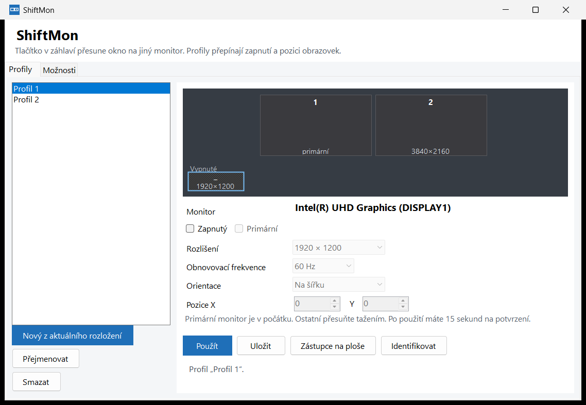
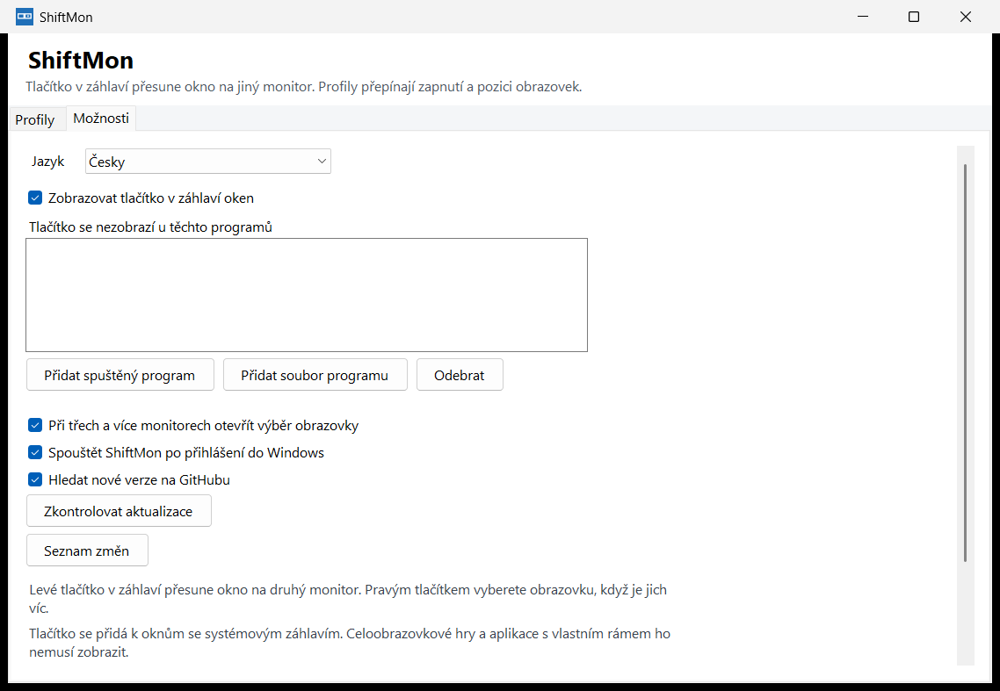

# ShiftMon

Tlačítko v záhlaví přesune okno na jiný monitor. Profily ukládají, které obrazovky jsou zapnuté a kde leží.

Program je pro 64bitový Windows 10 a Windows 11. Na cílovém počítači nemusí být nainstalovaný .NET. Instalace je jen pro přihlášeného uživatele, správce není potřeba.

## Vzhled

Hlavní okno skládá obrazovky a ukládá je do profilu. Vypnutá obrazovka je v editoru dole a do ikony zástupce se nekreslí.



V možnostech se volí jazyk, tlačítko v záhlaví a programy, u kterých se tlačítko neukáže.



Zástupce profilu na ploše má ikonu podle uloženého rozložení. Jsou na ní jen zapnuté obrazovky, primární modře a ostatní šedě. Po uložení profilu se ikona překreslí.

## Instalace

Stáhněte `ShiftMon-Setup.exe` z [nejnovějšího vydání](https://github.com/uzivatel457/ShiftMon/releases/latest) a spusťte ho.

ShiftMon se přidá do nabídky Start, spouští se po přihlášení a je vidět v **Nastavení → Aplikace**, odkud ho jde odebrat.

## Aktualizace

Jednou denně se podívá na GitHub. Když je vydaná novější verze, ukáže seznam změn a nabídne instalaci. Kontrolu lze vypnout v Možnostech, nebo ji spustit ručně.

## Sestavení

```powershell
installer\Build-Setup.ps1
```

Výsledkem je `dist\ShiftMon-Setup.exe`.
